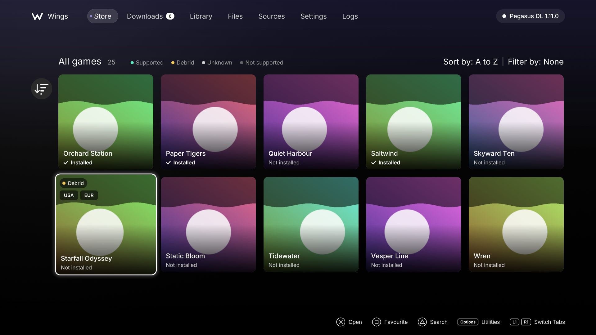
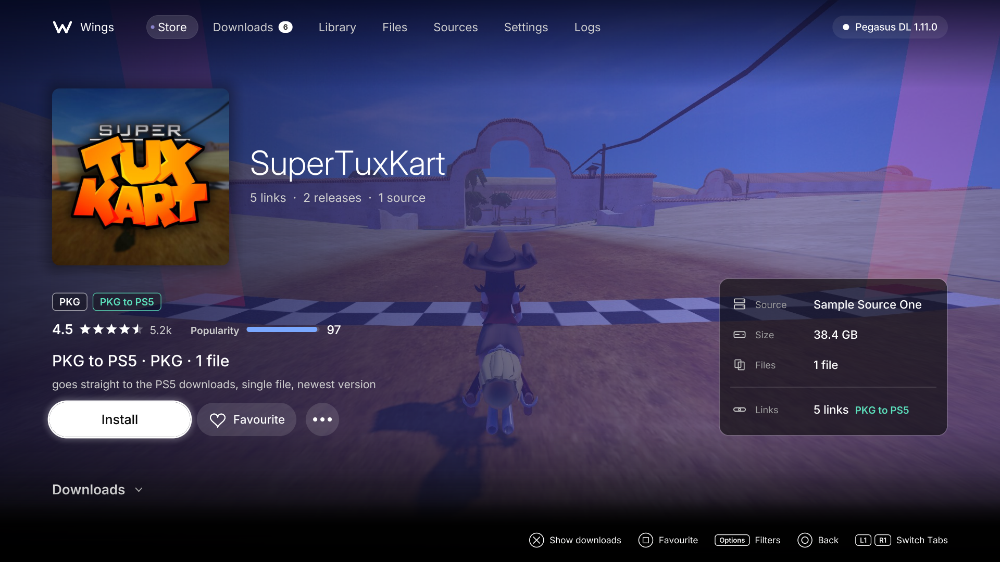
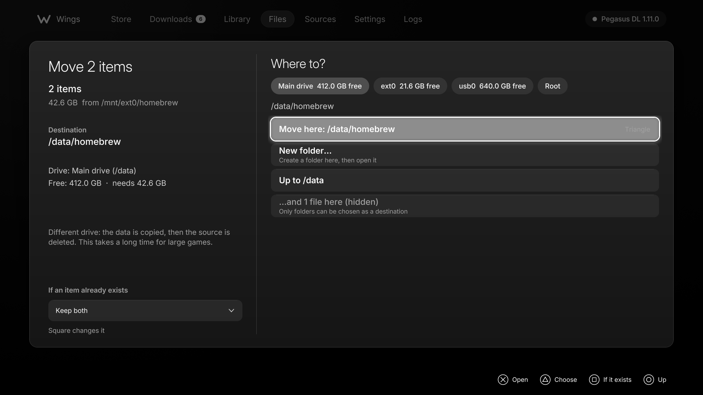
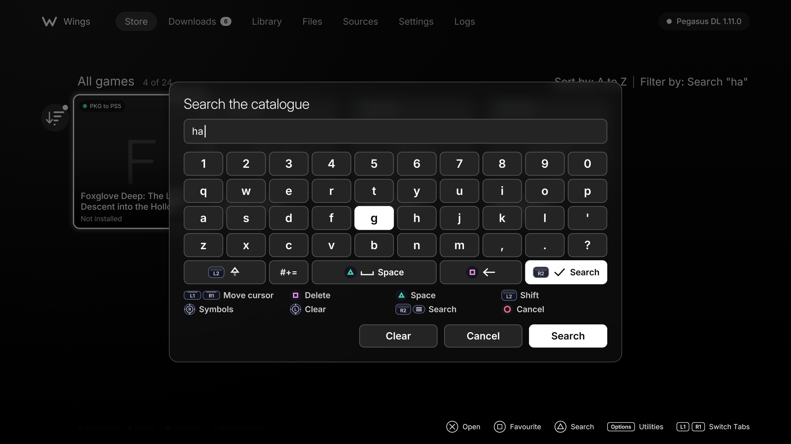
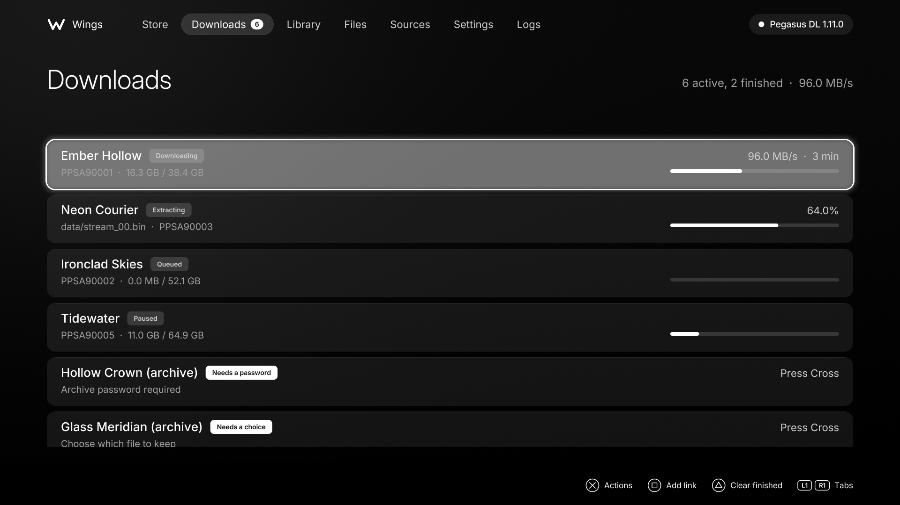
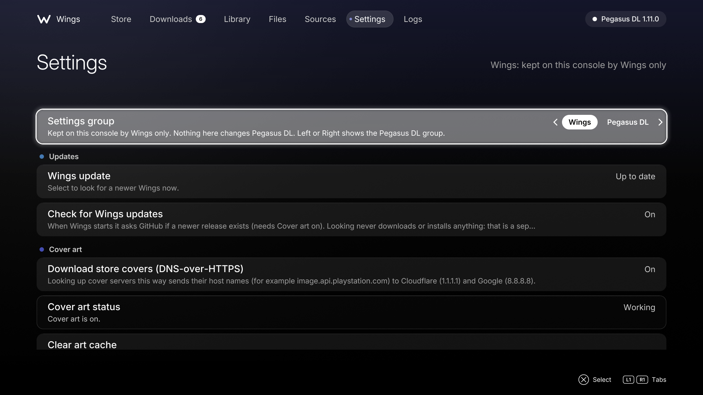

# Wings

### A native PS5 front end for Pegasus DL, made for the couch and a controller.

One clean page per game. See what every link is before you press it. Manage your files. Let Pegasus do the downloading.

[Screenshots](#screenshots) &middot; [Credits](#credits) &middot; [Features](#features) &middot; [Install](#install) &middot; [Quick start](#quick-start) &middot; [Guides](#guides) &middot; [Controls](#controls) &middot; [Privacy](#privacy) &middot; [License](#license)

| What Wings is | What Wings is not |
|---|---|
| A PS5 app (title ID `PPSA99178`) that is a front end for a **Pegasus DL you already run** on the same console, through its local API at `127.0.0.1:6970`. | Not Pegasus DL, not affiliated with its author, and not a replacement for it. Pegasus does the downloading, installing and extracting. |
| A better way to browse what Pegasus already knows: games grouped one per tile, links explained, files managed with a controller. | Not a source of games. Wings ships **no catalogues, no sources and no download links**. Only play and use games you legally own and are permitted to install. |
| Free software, GPL-3.0-or-later, built on the TV app of Orbit Store. | Not Orbit Store. None of Orbit's backend (payload, loader, pairing, update feeds) is in Wings. |

> **Use it responsibly.** Wings is a front end: it ships no catalogues, sources or links. Use it only with content you own or have permission to download, the same as Pegasus DL asks.
>
> Wings never bundles or redistributes Pegasus DL, and does nothing if it is already running. If it is not running, the waiting screen offers three choices straight away: load it once, turn on Auto-Load, or load it yourself. Only when you choose, Wings downloads the author's official release from its own release page on github.com, checks it against the SHA-256 GitHub publishes, and sends it to the payload loader on this console (`127.0.0.1:9021`). It never sends while Pegasus answers and never writes into any payload manager's folder. See [Pegasus auto-load](docs/guides/pegasus-autoload.md).

## Screenshots

Rendered from a stand-in back-end. May not represent actual.

  
  

  
  

  
  

## Credits

Wings exists because of other people's work. Thank you.

- **Orbit Store**, by **saawant12**: the TV app Wings began as, and the design language that made a controller-first PS5 app feel right. [orbit-store-ps5](https://github.com/saawant12/orbit-store-ps5)
- **Pegasus DL**, by the developer(s) at [pegasus-ps5](https://github.com/pegasus-ps5/pegasus-dl): the download manager Wings is a front end for.
- **PS5Upload**, by **phantomptr**: a great development environment while building and testing Wings. [ps5upload](https://github.com/phantomptr/ps5upload)
- **ShadowMountPlus**, by **drakmor**: mounts and registers the app and your games. [ShadowMountPlus](https://github.com/drakmor/ShadowMountPlus)
- **kstuff** ([ps5-payload-dev](https://github.com/ps5-payload-dev/kstuff)) and **kstuff-lite** (by **EchoStretch**, [kstuff-lite](https://github.com/EchoStretch/kstuff-lite)).
- **BlackBearReloaded**: the PS5 UI kit, boilerplate and tooling (`ps5-homebrew-ui`, `ps5-native-app-boilerplate`, `ps5-opengl`).
- **ps5-payload-dev** (SDK and ports) and **SvenGDK** ([SharpProspero](https://github.com/SvenGDK/SharpProspero)).
- Popularity data: **IGDB.com**, **Steam** and **Wikimedia** (see [Popularity data and privacy](docs/guides/popularity-and-privacy.md)).

Libraries, fonts and versions are listed in full in [CREDITS.md](CREDITS.md). If something you wrote is missing or wrong there, please open an issue.

## Features

- **One game, one page.** The same game from several sources is merged into one tile. Its page groups what is available into Base, Update and DLC, then by release, with every mirror shown as a card.
- **Know the link before you press it.** A card shows the host, region, the firmware it needs (and the lowest firmware a back-port runs on), format (exFAT, FPKG, PKG), version and how it will download. Where a link points at a known wrapper page, Wings takes the host from the link's name instead.
- **A "Best" pick that explains itself.** A link that needs a newer firmware than yours is never Best while anything else exists. Then: native `.pkg`, debrid, automatic providers, browser capture; then firmware fit, region, format, fewer parts, known size, newest version, source order. The card says why, for example `Debrid · USA · 12.xx · exFAT · 1 file`. See [Link types and what Best means](docs/guides/link-types.md).
- **Multi-part archives as one card**, with a warning when a numbered set has gaps, and a **Download all parts** action that asks first and can be stopped with Circle after the part in flight.
- **Filters that fit the data.** On a game page: firmware ("Runs on my firmware"), region, format, host, source, single file only, no browser needed. The Store grid has its own filters and a "Single file only" switch. The sort of mirrors inside a release can be Best, newest, fewest parts or host.
- **Search like the PlayStation one.** Triangle opens a search box with an on-screen keyboard, results update as you type, recent searches are kept as chips. The touchpad slides over the keys and a click types.
- **A Files tab built for a controller.** One list from `/` with drive chips and a breadcrumb, multi-select, copy, move, rename, delete, extract, install `.pkg`, a "Where to?" destination browser, an operations list with a visible way to cancel.
- **Archive passwords.** When an archive asks for a password Wings tries six well-known public passwords one at a time before it asks you. See [Archive passwords](docs/guides/archive-passwords.md).
- **Everything Pegasus does, in one place.** Downloads queue, Library (installed games and APR Emu), Sources, Logs, and Settings split into **Wings** (kept on the console by Wings) and **Pegasus DL** (changes Pegasus, labelled as such).
- **Cover art.** Store posters are downloaded over HTTPS by Wings itself and cached on the console (up to 96 MiB). **On by default**; turn it off in Settings.
- **Optional popularity.** Sort by most popular or highest rated, and show a score and rating on tiles, from a small public data file. **On by default**; turn it off in Settings. See [Popularity data and privacy](docs/guides/popularity-and-privacy.md).
- **Tile details setting.** Store tiles show their link tier and regions Always, On focus (default) or Never.

## Install

**You need** a PS5 that can run homebrew, with:

- **kstuff**, so a fake-signed app starts, and
- **ShadowMountPlus**, so the package mounts and its tile appears.

This is the same setup Orbit Store asks for. Pegasus DL must be running on the console when you open Wings.

1. Download `PPSA99178.ffpkg` from the [latest release](https://github.com/LaRazaDelSol/wings-app/releases/latest).
2. Check the file. On Windows, in PowerShell: `Get-FileHash .\PPSA99178.ffpkg -Algorithm SHA256`. The value must equal the SHA-256 shown on the release page (case does not matter). If it does not, download again.
3. Copy the file to `/data/homebrew/` on the console (FTP or your usual file transfer). Check that the size on the console equals the size on the release page.
4. Wait about ten seconds. ShadowMountPlus registers it and a **Wings** tile appears in the Games row.
5. Open **Wings**.

To replace an older build under the same title ID, replace the file, remove the staged copies ShadowMountPlus made, then restart the jailbreak chain so the new package is mounted. To remove Wings, delete the `.ffpkg`; see section 10 of [FIRST-CONSOLE-TEST.md](docs/FIRST-CONSOLE-TEST.md).

Wings writes only to its own folders: `/download0/wings/` (cover cache, settings, diagnostics, inside the title's storage) and `/data/wings/` (diagnostics and a copy of the settings, so you can read them in the file manager).

## Quick start

1. Start Pegasus DL on the console and wait until its web UI answers.
2. Open Wings. A pill at the top right says "Connecting", then "Pegasus DL" with its version. If it says **Waiting for Pegasus DL**, Wings keeps trying; start Pegasus.
3. **Store**: tiles for your catalogue, one per game. Triangle searches, Options opens utilities, and the sort and filter button sits in the grid header.
4. Cross on a tile opens its page. The **Best** card is on top; Cross downloads it. Pegasus takes over: watch it in **Downloads**.
5. When it finishes, **Library** shows installed games and **Files** shows where things are.
6. First-run settings worth a look: Settings, **Wings** group, **Link ranking** (your firmware, region and format, so Best fits your console) and **Cover art** / **Popularity data** (both on by default).

More detail: [Getting started](docs/guides/getting-started.md).

## Guides

| Guide | |
|---|---|
| [Getting started](docs/guides/getting-started.md) | Tabs, first run, settings to set once |
| [Finding and downloading a game](docs/guides/finding-and-downloading.md) | Search, filters, game page, queue |
| [Link types and what Best means](docs/guides/link-types.md) | Colours, tiers, the ranking order |
| [The Files tab](docs/guides/files-tab.md) | Browse, select, copy, move, extract, install, cancel |
| [Archive passwords](docs/guides/archive-passwords.md) | The auto-try, the prompt, "choose what to keep" |
| [After a download: ShadowMount scan](docs/guides/after-install-scan.md) | Why a new game waits for Wings to close, and the banner |
| [Popularity data and privacy](docs/guides/popularity-and-privacy.md) | What is fetched, from where, how to stop it |
| [Troubleshooting and FAQ](docs/guides/troubleshooting.md) | Waiting for Pegasus, covers, "extraction failed", diagnostics |

## Controls

| Button | In lists and grids | In the keyboard |
|---|---|---|
| Cross | Open / confirm | Type the key |
| Circle | Back / up | Cancel (keeps your old search) |
| Square | Favourite a game; select a file | Delete |
| Triangle | Search; actions menu in Files | Space (shows the text in a password field) |
| Options | Utilities (Store), Filters (game page), Operations (Files) | Run the search |
| L1 / R1 | Switch tab | Move the cursor |
| R2 | | Run the search |
| L2 | | Shift |
| R3 / L3 | | Symbols / Clear |
| Touchpad | Swipe to scroll or switch tab; click to filter in Files | Slide over the keys, click to type |

On a download in Downloads, Cross opens its actions (resume, retry, enter a password, choose what to keep). In Files, while an operation runs, Square cancels it and Triangle opens its destination.

## Privacy

Wings has no account, no telemetry that this project operates, and no analytics. To the best of the source tree, the console connects to:

| When | To | Why |
|---|---|---|
| Always | `127.0.0.1:6970` (Pegasus DL on the same console) | Everything Wings shows and does goes through it. |
| Cover art **on** (default) | Cloudflare `1.1.1.1` and Google `8.8.8.8` over HTTPS (DNS-over-HTTPS) | Looking up cover servers. They see the host names, for example `image.api.playstation.com`. |
| Cover art **on** | The cover servers named in your catalogue's poster URLs, over HTTPS | Downloading the images. Those servers see the console's IP address. |
| Only when you press Check, or at most every 6 hours while Settings > Pegasus DL is open (needs Cover art on) | `api.github.com` (the author's release list, one small file) | Showing the latest official Pegasus DL version. GitHub sees the console's IP address. |
| Only when you press Download and confirm | `github.com`, then GitHub's `objects.githubusercontent.com` | The official `Pegasus-dl.elf` (about 20 MB), checked against GitHub's SHA-256 before it is saved. Nothing else is accepted. |
| Popularity **on** (default) | `larazadelsol.github.io` (GitHub Pages), one file, at most once per 24 hours | Scores and ratings, keyed by title ID. GitHub sees the console's IP address. The file has no user data and Wings sends no identifier beyond a fixed `WingsTV/0.1` User-Agent. |

Turn **Cover art** off and Popularity (which needs it) stops too: Wings then makes **no internet connection at all**. Pegasus DL has its own network behaviour (sources, debrid, downloads); that is Pegasus, not Wings. Details: [Popularity data and privacy](docs/guides/popularity-and-privacy.md).

The diagnostics report (`/data/wings/diagnostics.txt`) contains no tokens or links and is meant to be safe to share. The title log (`app.log`) can contain Pegasus log lines; read it before posting.

## Build from source

From the repository root, inside WSL with Docker: `bash tools/build-wings-wsl.sh` (add `WITH_TEST=1` for the host unit tests and `WITH_PREVIEW=1` for the PNG preview). See [docs/build.md](docs/build.md). The core library (`core/`) builds with any C++17 compiler; see [core/README.md](core/README.md).

## License

Wings is free software under the **GNU General Public License, version 3 or (at your option) any later version**, the same license as the Orbit Store TV app it is built on. See [LICENSE](LICENSE), [NOTICE](NOTICE) and [CREDITS.md](CREDITS.md). It comes with no warranty. Pegasus DL is not part of this project and is not covered by this license.
